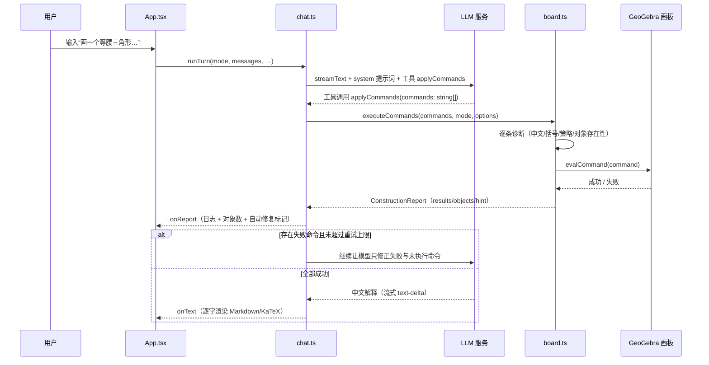

# AI 几何画板（AIGeoGebra）

> 用一句自然语言，让 AI 在 GeoGebra 画板上作图、计算概率、求值，并自动检查、自动纠错、用中文解释每一步。

`AIGeoGebra` 是一个面向数学教学与演示场景的 Web 应用：左侧和 AI 对话，右侧内嵌真实的 [GeoGebra](https://www.geogebra.org/) 计算器。AI（大语言模型）负责把用户的自然语言需求翻译成 GeoGebra 命令并调用画板执行，执行结果实时回显，失败的命令会被自动诊断并重试一次。

---

## 目录

- [1. 项目简介](#1-项目简介)
- [2. 功能特性](#2-功能特性)
- [3. 界面与使用手册](#3-界面与使用手册)
  - [3.1 界面布局](#31-界面布局)
  - [3.2 四种计算模式](#32-四种计算模式)
  - [3.3 命令执行日志](#33-命令执行日志)
  - [3.4 快捷键](#34-快捷键)
  - [3.5 会话与偏好持久化](#35-会话与偏好持久化)
- [4. 技术架构](#4-技术架构)
  - [4.1 技术栈](#41-技术栈)
  - [4.2 整体架构](#42-整体架构)
  - [4.3 一次作图请求的完整流程](#43-一次作图请求的完整流程)
  - [4.4 失败重试机制](#44-失败重试机制)
- [5. 目录结构](#5-目录结构)
- [6. 本地开发](#6-本地开发)
  - [6.1 环境要求](#61-环境要求)
  - [6.2 安装与启动](#62-安装与启动)
  - [6.3 常用命令](#63-常用命令)
  - [6.4 开发环境代理说明](#64-开发环境代理说明)
- [7. 生产部署（腾讯 EdgeOne）](#7-生产部署腾讯-edgeone)
  - [7.1 构建](#71-构建)
  - [7.2 部署步骤](#72-部署步骤)
  - [7.3 平台环境变量](#73-平台环境变量)
  - [7.4 Edge Functions 说明](#74-edge-functions-说明)
- [8. 环境变量](#8-环境变量)
- [9. 核心模块设计](#9-核心模块设计)
  - [9.1 App.tsx — 界面与状态](#91-apptsx--界面与状态)
  - [9.2 modes.ts — 模式定义](#92-modests--模式定义)
  - [9.3 board.ts — GeoGebra 封装](#93-boardts--geogebra-封装)
  - [9.4 chat.ts — LLM 对话与工具调用](#94-chatts--llm-对话与工具调用)
  - [9.5 prompt.ts — 系统提示词](#95-promptts--系统提示词)
  - [9.6 policy.ts — 命令校验策略](#96-policyts--命令校验策略)
  - [9.7 probability.ts — 概率计算器同步](#97-probabilityts--概率计算器同步)
  - [9.8 session.ts — 本地持久化](#98-sessionts--本地持久化)
  - [9.9 markdown.ts — 渲染与消毒](#99-markdownts--渲染与消毒)
- [10. HTTP 接口说明](#10-http-接口说明)
- [11. 功能完成度一览](#11-功能完成度一览)
- [12. 后续规划（Roadmap）](#12-后续规划roadmap)
- [13. 常见问题（FAQ）](#13-常见问题faq)
- [14. 安全提示](#14-安全提示)

---

## 1. 项目简介

**AI 几何画板**解决一个具体痛点：传统 GeoGebra 功能强大，但命令语法（英文命令名、参数顺序、括号规则）对师生有学习成本；而通用聊天机器人只能“说”图形，无法“画”图形。

本项目把两者结合起来：

1. 用户在对话框用中文描述需求，例如“画三角形 ABC，A(0,0)、B(4,0)、C(1,3)，并作出 AB 边上的高”；
2. 大模型将需求翻译为有序的 GeoGebra 命令，并通过工具调用提交；
3. 前端把命令逐条注入真实 GeoGebra 画板执行；
4. 执行结果（成功/失败/未执行、对象数量、数值结果）以日志形式展示；
5. 若某条命令失败，系统会带着失败原因让模型修正后重新执行一次，且不会重复已经成功的命令；
6. 模型最后用中文解释作图步骤或计算结果，公式以 KaTeX 渲染。

项目同时提供四种计算器：**几何、3D、概率、科学计算**，每种模式拥有独立的会话记录和偏好设置。

---

## 2. 功能特性

### 2.1 四种 AI 计算模式

| 模式 | 内嵌计算器 | 典型能力 | 提交按钮 | 日志标题 |
| --- | --- | --- | --- | --- |
| 几何 | GeoGebra Geometry（几何） | 点、线、圆、多边形、函数、交点等平面图形 | 作图 | 命令 |
| 3D | GeoGebra 3D（3D 计算器） | 空间点、平面、球、棱锥、棱柱、圆柱、圆锥、曲面等 | 作图 | 命令 |
| 概率 | GeoGebra Classic（概率计算器透视图） | 正态/t/卡方/F/二项/泊松等分布的概率、区间、分位数 | 计算 | 命令 |
| 科学计算 | GeoGebra Scientific（科学计算器） | 四则运算、幂、阶乘、三角函数、对数、取整等 | 计算 | 算式 |

### 2.2 自然语言驱动

- 支持中文自然语言描述，无需记忆 GeoGebra 语法；
- 每个模式内置 4 个示例，点击即可一键执行；
- 模型输出支持 Markdown 与 KaTeX 公式，`$...$` 行内公式、`$$...$$` 块级公式均可渲染。

### 2.3 命令自动执行与纠错

- 模型通过 `applyCommands` 工具提交命令，一次最多 24 条，按顺序执行；
- 遇到第一条失败命令立即停止，后续命令标记为“未执行”；
- 失败原因分为三类：中文/全角字符、括号不匹配、策略不允许、引用了不存在的对象等；
- 失败后自动携带错误信息让模型修正并重新执行，只重跑失败与未执行的命令；
- 整个对话最多 3 步（含文本回答步骤），避免无限循环。

### 2.4 命令日志与结果回显

- 右侧日志逐条展示命令、状态（已执行/失败/未执行）、错误原因、数值结果；
- 每条命令可一键复制，复制后显示“已复制”反馈；
- 日志头显示对象总数；发生过自动修复时显示“已自动修改并重新执行”；
- 科学计算与概率计算会回显每个赋值算式的结果值。

### 2.5 会话与偏好持久化

- 四个模式的对话记录、输入草稿、执行报告分开保存到浏览器 `localStorage`；
- 切换模式后回来，会自动重放历史成功命令，恢复画板图形；
  新保存的会话使用完整画板 XML 快照恢复，包含多轮作图、纠错前已成功的构造和手动编辑；没有快照的旧会话仍重放其保存的成功命令。
- 记住上次使用的模式、坐标系显隐、日志显隐、角度/弧度单位等偏好；
- 兼容旧版本存储结构（`aiggb.messages` 等）并自动迁移。

### 2.6 交互细节

- 流式输出：模型回答逐字显示，不必等完整响应；
- `Enter` 提交、`Shift+Enter` 换行、`Ctrl+Enter` 提交、`Esc` 停止当前请求；
- 响应式布局：窄屏（< 860px）自动切换为上下单栏结构；
- 加载态、禁用态、未配置提示、超时提示等状态完整。

---

## 3. 界面与使用手册

### 3.1 界面布局

页面分为三部分：

```
┌─────────────────────────────────────────────────────────────────┐
│ 头部：模式标题 / 模型状态 / 模式切换（几何 · 3D · 概率 · 科学）      │
├──────────────────────────────┬──────────────────────────────────┤
│ 左侧：会话区                  │ 右侧：画板区                      │
│  · 示例按钮（4 个）           │  · 工具栏（坐标系 / 角度单位 /     │
│  · 对话记录（气泡）           │    日志显隐）                    │
│  · 流式草稿                  │  · GeoGebra 画板                 │
│  · 错误/配置提示             │  · 命令执行日志                   │
│  · 输入框 + 清空 + 提交按钮   │                                  │
└──────────────────────────────┴──────────────────────────────────┘
```

- **头部**：当前模式的标题与简介，模型配置状态（“当前模型 xxx”或“模型未配置”），以及四个模式切换按钮；
- **左侧会话区**：示例按钮、历史对话气泡、正在流式输出的草稿、错误横幅、输入框与操作按钮；
- **右侧画板区**：模式专属工具栏、GeoGebra 画板、命令/算式执行日志。

### 3.2 四种计算模式

#### 3.2.1 几何模式

- 输入示例：
  - `画三角形 ABC，A(0,0)、B(4,0)、C(1,3)，并作出 AB 边上的高`
  - `画一个圆和圆外一点，过该点作圆的两条切线`
  - `画出函数 f(x)=x^2-2 与直线 y=x，并标出交点`
  - `画一个平行四边形，并作出它的两条对角线`
- 右上角可切换**显示/隐藏坐标系**（同时控制坐标轴与网格）；
- 生成的是平面图形命令（点、线段、直线、圆、多边形、函数、交点等）。

#### 3.2.2 3D 模式

- 输入示例：
  - `画棱锥 ABCD，底面 A(0,0,0)、B(3,0,0)、C(1,2,0)，顶点 D(1,1,3)`
  - `画球心 O(0,0,0)、半径为 2 的球`
  - `画平面 ABC，A(0,0,0)、B(2,0,0)、C(0,2,1)，以及直线 PQ，P(0,0,2)、Q(2,2,0)，并标出交点`
  - `画出曲面 f(x, y) = x^2 + y^2`
- 画板支持旋转、缩放查看空间图形；
- 仅允许白名单命令：`Segment`、`Line`、`Polygon`、`Plane`、`Sphere`、`Prism`、`Pyramid`、`Cylinder`、`Cone`、`Intersect`、`Midpoint`。

#### 3.2.3 概率模式

- 输入示例：
  - `标准正态分布，求小于 1.96 的概率`
  - `二项分布：10 次独立试验，每次成功概率 0.5，求恰好成功 6 次的概率`
  - `泊松分布，平均次数为 3，求次数不超过 2 的概率`
  - `画出自由度为 5 的卡方分布密度曲线`
- 成功的分布命令会同时更新 GeoGebra 概率计算器的**分布菜单、参数、区间和曲线**；
- 支持左尾、右尾、区间、点概率、分位数等问法。

#### 3.2.4 科学计算模式

- 输入示例：
  - `计算 30 度的正弦，再加上 log(100)`
  - `计算 5 的阶乘与根号 2 的和`
  - `计算 2.5 乘以 10 的 3 次方，再乘以 3.2 乘以 10 的 -1 次方`
  - `计算 e 的平方，再向下取整`
- 右上角可切换**角度/弧度**单位，模型生成的三角表达式会按当前单位书写；
- 每条命令写成 `名字 = 表达式` 的形式，结果值显示在日志中。

### 3.3 命令执行日志

日志列表位于画板下方（可折叠，通过“隐藏/显示命令（算式）”按钮控制），每条记录包含：

| 元素 | 说明 |
| --- | --- |
| `code` | 实际执行的 GeoGebra 命令原文 |
| 状态 | `已执行`（绿）、`失败`（红）、`未执行`（灰） |
| 复制按钮 | 点击复制命令，1.2 秒内显示“已复制” |
| 错误信息 | 失败时的中文诊断，例如“命令里含有中文……”“括号不匹配”“对象 A 还不存在” |
| 结果值 | 科学/概率模式下赋值表达式的结果 |
| 对象数 | 日志头显示当前画板对象总数 |

### 3.4 快捷键

| 快捷键 | 作用 |
| --- | --- |
| `Enter` | 提交输入（光标在输入框内） |
| `Shift+Enter` | 输入换行 |
| `Ctrl+Enter` / `Cmd+Enter` | 全局提交 |
| `Esc` | 停止当前进行中的请求 |

### 3.5 会话与偏好持久化

| 存储键 | 内容 |
| --- | --- |
| `aiggb.sessions` | 四个模式各自的对话消息、输入草稿、执行报告 |
| `aiggb.mode` | 上次使用的模式 |
| `aiggb.axes` | 几何模式坐标系显隐 |
| `aiggb.commands` | 命令/算式日志显隐 |
| `aiggb.angle` | 科学计算角度单位（degree / radian） |
| `aiggb.cloud.<用户ID>.<模式>` | 该账号尚未同步的云端会话副本；同步成功后删除 |

登录后的修改会先保留本机待同步副本。同步失败时可点击「重试同步」，刷新或切换模式后仍能恢复；副本按账号隔离，不会作为游客会话展示。设置里的清空本机缓存也会删除这些待同步副本。旧版本已经丢失、且未保存的历史命令无法补回。

第一阶段的修复范围、验证方式与后续人工验收见 [第一阶段记录](docs/stage-1.md)。

---

## 4. 技术架构

### 4.1 技术栈

| 层次 | 技术 | 说明 |
| --- | --- | --- |
| 前端框架 | SolidJS 1.9 | 响应式 UI |
| 语言 | TypeScript 5.8 | 严格模式 |
| 构建 | Vite 7 + vite-plugin-solid | 开发服务器 / 打包 |
| 画板 | GeoGebra `deployggb.js`（5.4.931.2 web3d codebase） | 官方脚本动态加载 |
| AI | `ai`（AI SDK 6）+ `@ai-sdk/openai-compatible` | 流式对话 + 工具调用 |
| 校验 | zod | 工具参数 schema |
| 渲染 | marked + marked-katex-extension + KaTeX + DOMPurify | Markdown/公式渲染与 XSS 消毒 |
| 持久化 | localStorage（@solid-primitives/storage） | 会话与偏好 |
| 部署 | 腾讯 EdgeOne Pages + Edge Functions | 静态资源 + 服务端代理 |

### 4.2 整体架构

```
┌──────────────────────────── Browser ────────────────────────────┐
│                                                                 │
│  SolidJS UI (App.tsx)                                          │
│    ├── 会话区：消息、草稿、输入框、示例、错误提示                  │
│    └── 画板区：GeoGebra 画板、工具栏、命令日志                   │
│            │                    │                               │
│  chat.ts（LLM 对话）      board.ts（GeoGebra 封装）             │
│    ├── runTurn               ├── mountBoard / resizeBoard       │
│    ├── streamText            ├── executeCommands                │
│    ├── applyCommands 工具     ├── 命令诊断（policy.ts）          │
│    └── 重试控制               └── 概率计算器同步（probability.ts）│
│            │                    │                               │
│  prompt.ts（系统提示词）    session.ts（localStorage）           │
│  markdown.ts（渲染）        types.ts（类型）                     │
└──────────────┬─────────────────────────────────────────────────┘
               │ 同源请求
┌──────────────▼─────────────────────────────────────────────────┐
│  开发：Vite 中间件 /api/status + /llm 代理                       │
│  生产：EdgeOne Edge Functions（functions/）                     │
│    · GET /api/status        返回 LLM 配置状态                    │
│    · /llm/*                 转发到 LLM_BASE_URL 并注入 API Key   │
└──────────────┬──────────────────────────┬───────────────────────┘
               │                          │
        ┌──────▼──────┐            ┌──────▼──────────┐
        │ LLM 服务    │            │ GeoGebra CDN    │
        │ (OpenAI兼容)│            │ (deployggb.js)  │
        └─────────────┘            └─────────────────┘
```

### 4.3 一次作图请求的完整流程



### 4.4 失败重试机制

1. 模型的第一步**强制**调用 `applyCommands`（`toolChoice: { type: 'tool', toolName: 'applyCommands' }`）；
2. 命令逐条执行，遇到第一条失败立即停止，后续命令标记 `skipped`；
3. 若某步工具结果中存在失败，且工具调用次数未超过 2 次，系统提示词强制模型再次调用工具；
4. 报告中的 `hint` 明确要求模型“只提交修正后的失败命令和尚未执行的命令，不要重复已成功的命令”；
5. 整个对话通过 `stopWhen: stepCountIs(3)` 限制为最多 3 步，防止死循环；
6. 对 DeepSeek 的 `deepseek-flash` / `deepseek-reasoner` / `deepseek-v*` 等默认开启思考模式的模型，请求体会自动注入 `thinking: { type: 'disabled' }`，因为思考模式拒绝指定具体工具，而作图必须调用 `applyCommands`。

---

## 5. 目录结构

```
AIGeoGebra/
├── index.html                      # 应用入口 HTML
├── package.json                    # 依赖与脚本
├── tsconfig.json                   # TypeScript 配置
├── vite.config.ts                  # Vite 配置（含 /api/status 与 /llm 代理）
├── .env.example                    # 环境变量样例
├── .gitignore
├── src/
│   ├── index.tsx                   # 挂载根组件，引入 KaTeX 与全局样式
│   ├── App.tsx                     # 主界面：模式切换、会话、提交、日志、偏好
│   ├── board.ts                    # GeoGebra 脚本加载、挂载、命令执行、诊断
│   ├── chat.ts                     # LLM 流式对话、工具定义、重试控制
│   ├── prompt.ts                   # 各模式系统提示词
│   ├── policy.ts                   # 命令白名单与语法校验
│   ├── probability.ts              # 概率计算器分布/区间 XML 同步
│   ├── session.ts                  # localStorage 会话持久化与旧数据迁移
│   ├── markdown.ts                 # Markdown + KaTeX 渲染 + DOMPurify 消毒
│   ├── modes.ts                    # 四种模式的元数据定义
│   ├── types.ts                    # 全局类型
│   ├── styles.css                  # 全局样式（含响应式）
│   ├── pb.ts                       # PocketBase SDK 与 authStore
│   ├── api.ts                      # 验证码、模型、用量和云端会话请求
│   ├── AccountBar.tsx              # 顶栏登录入口与用户菜单
│   ├── pages/                      # 登录、注册、找回密码、协议、工作台、设置
│   └── vite-env.d.ts               # Vite 与 window.GGBApplet 类型声明
├── pb_migrations/                  # PocketBase 迁移（随 serve --migrationsDir 加载）
├── pb_hooks/                       # 验证码、注册、用量汇总钩子
├── functions/                      # EdgeOne Edge Functions
│   ├── _lib/                       # 模型列表、用量写入、流式代理
│   ├── api/                        # /api/status、/api/config、/api/models、/api/gateway
│   └── llm/
│       └── [[path]].js             # /llm/* 转发代理
├── dist/                           # 构建产物（npm run build 生成）
└── .edgeone/                       # EdgeOne 部署产物（project.json、edge-functions、assets）
```

---

## 6. 本地开发

### 6.1 环境要求

- Node.js ≥ 20.19（Vite 7 要求；建议使用当前 LTS）
- npm（项目无 `packageManager` 锁定制，使用 npm 即可）
- 一个可用的 OpenAI 兼容 LLM 接口（默认以 DeepSeek 为例）
- 能够访问 `https://www.geogebra.org/`（画板脚本从官方 CDN 动态加载）

### 6.2 安装与启动

```bash
# 1. 安装依赖
npm install

# 2. 准备环境变量
cp .env.example .env
# 编辑 .env，填入 LLM_BASE_URL / LLM_API_KEY / LLM_MODEL

# 3. 启动开发服务器
npm run dev
```

启动后访问 `http://localhost:5173`。开发服务器以 `host: true` 启动，同一局域网设备可通过本机 IP 访问。

若头部显示“模型未配置”，请检查 `.env` 三个变量是否都已填写，然后重启 `npm run dev`。

### 6.3 常用命令

| 命令 | 作用 |
| --- | --- |
| `npm run dev` | 启动开发服务器（端口 5173） |
| `npm run build` | 类型检查（`tsc --noEmit`）+ 生产构建到 `dist/` |
| `npm test` | 运行画板快照、概率同步、请求中止、云端恢复和账号隔离回归测试（外部服务使用模拟实现） |
| `npm run preview` | 本地预览生产构建产物 |

### 6.4 开发环境代理说明

浏览器端只发起同源请求，避免暴露密钥与跨域问题：

- `GET /api/status`：由 `vite.config.ts` 中 `llm-status` 插件处理，返回 `.env` 的配置状态；
- `/llm/*`：由 Vite proxy 转发到 `LLM_BASE_URL`，自动追加 `Authorization: Bearer <LLM_API_KEY>`，并设置 `cache-control: no-cache`、`x-accel-buffering: no` 以保证 SSE 流式响应不被缓冲。

因此浏览器代码中只出现相对地址 `/llm` 和 `/api/*`，密钥始终留在服务端（开发时为本地 `.env`，生产时为平台环境变量）。浏览器登录后，用单独的 `X-PB-Token` 把头里的 PocketBase token 交给代理；代理再用超级用户身份向 PocketBase 校验，并换成上游模型密钥，避免和现有的 `Authorization` 注入互相覆盖。

### 6.5 PocketBase

账号、云端会话和用量存在本机 PocketBase 0.40.4。数据目录在仓库外，邮件设置已经由超级用户配好，迁移不会创建超级用户，也不会改写邮件设置。

启动时要显式使用仓库里的迁移和钩子，而不是数据目录里自动生成的迁移：

```bash
pocketbase.exe serve --dir <用户的数据目录> --migrationsDir <仓库>/pb_migrations --hooksDir <仓库>/pb_hooks
```

本机示例：

```bash
D:\pocketbase\pocketbase.exe serve --http=127.0.0.1:8090 --dir D:\pocketbase\pb_data --migrationsDir D:\Grade3Proj\AIGeoGebra\pb_migrations --hooksDir D:\Grade3Proj\AIGeoGebra\pb_hooks
```

开发时 `PB_URL` 为 `http://127.0.0.1:8090`。边缘函数要能写入用量，`PB_URL` 必须是边缘函数访问得到的地址；`127.0.0.1` 只用于本地开发。

---

## 7. 生产部署（腾讯 EdgeOne）

项目面向 EdgeOne Pages 部署：静态资源由 EdgeOne 分发，两个服务端接口由 Edge Functions 承担。

### 7.1 构建

```bash
npm run build
```

产物输出到 `dist/`。构建脚本会先执行 `tsc --noEmit` 做类型检查，再执行 `vite build`。

### 7.2 部署步骤

1. 将项目推送到 Git 仓库，并在 EdgeOne Pages 控制台导入该项目（或使用 EdgeOne CLI 部署）；
2. 构建命令填写 `npm run build`，输出目录填写 `dist`；
3. 在平台**环境变量**中配置 `LLM_BASE_URL`、`LLM_API_KEY`、`LLM_MODEL`（Edge Functions 通过 `context.env` 读取，与本地 `.env` 无关）；
4. 部署完成后访问站点域名。

已生成的 `.edgeone/` 目录包含项目绑定信息（`project.json`）、边缘函数路由（`edge-functions/config.json`）与静态资源配置（`assets/.edgeone-assets-config.json`，`framework: "solid"`、`needsFallback: true` 用于 SPA 回退）。

### 7.3 平台环境变量

| 变量 | 说明 |
| --- | --- |
| `LLM_BASE_URL` | OpenAI 兼容接口地址 |
| `LLM_API_KEY` | 模型供应商密钥 |
| `LLM_MODEL` | 模型名称 |

配置完成后重新部署。若未配置，`/api/status` 会返回 `configured: false`，页面显示“模型未配置”。

### 7.4 Edge Functions 说明

路由定义于 `.edgeone/edge-functions/config.json`：

```json
{
  "routes": [
    { "src": "^/api/status$" },
    { "src": "^/llm/(.*)$" }
  ]
}
```

- `functions/api/status.js`：`GET /api/status` 返回 `{ configured, model }`；
- `functions/llm/[[path]].js`：把 `/llm/chat/completions` 转发为 `{LLM_BASE_URL}/chat/completions`，注入 `Authorization`，透传 SSE 流并追加 `cache-control: no-cache` 与 `x-accel-buffering: no`，确保逐字输出。

---

## 8. 环境变量

完整环境变量如下（`.env.example`）：

| 变量 | 必填 | 说明 | 示例 |
| --- | --- | --- | --- |
| `LLM_BASE_URL` | 是 | OpenAI 兼容接口地址；供应商要求带 `/v1` 前缀时需包含 | `https://api.deepseek.com/v1` |
| `LLM_API_KEY` | 是 | 模型供应商 API Key | `sk-...` |
| `LLM_MODEL` | 是（未配置 `LLM_MODELS` 时） | 默认模型名称 | `deepseek-chat` / `deepseek-flash` |
| `LLM_MODELS` | 否 | 模型列表 JSON。元素为 `id`、`label`、`baseUrl`、`apiKey`、`gateway`。留空时列表只有上面这一项，且 `gateway` 为 false | `[{"id":"deepseek-chat","label":"DeepSeek","baseUrl":"https://api.deepseek.com/v1","apiKey":"","gateway":false}]` |
| `PB_URL` | 登录与用量需要 | PocketBase 地址。边缘函数必须填它访问得到的地址，本机开发用 `http://127.0.0.1:8090` | `http://127.0.0.1:8090` |
| `PB_SUPERUSER_EMAIL` | 写用量需要 | `_superusers` 集合中的超级用户邮箱。只放在 `.env` 或 EdgeOne 环境变量 | |
| `PB_SUPERUSER_PASSWORD` | 写用量需要 | 超级用户密码。不写进仓库 | |
| `AI_GATEWAY_API_KEY` | 否 | 可放进 `LLM_MODELS` 里 `gateway: true` 的项。页面不展示密钥 | `sk-...` |
| `AI_GATEWAY_BASE_URL` | 否（预留） | EdgeOne AI Gateway 地址 | `https://ai-gateway.edgeone.link/v1` |
| `AI_GATEWAY_MODEL` | 否 | 可写入 `LLM_MODELS` 的网关模型 id | `@makers/deepseek-v4-flash` |
| `MAKERS_MODELS_KEY` | 否 | 若网关使用单独密钥，把它放进对应 `LLM_MODELS` 项的 `apiKey`，不要下发到页面 | `sk-...` |

> 说明：`.env` 已加入 `.gitignore`，不会随代码提交。生产环境请在 EdgeOne 控制台配置，不要在仓库中保存真实密钥。

---

## 9. 核心模块设计

### 9.1 App.tsx — 界面与状态

主组件，负责所有 UI 状态与用户交互：

- 状态：`llm`（模型配置）、`boardReady` / `boardError`（画板状态）、`mode`（当前模式）、`sessions`（四模式会话）、`draft`（流式草稿）、`running`、`error`、`report`、`attempts`、`copied`、`showAxes` / `showCommands` / `angleUnit`（持久化偏好）；
- 模式切换：中断当前请求、清空草稿与错误、切换 `mode` 并重新加载对应画板；
- 会话恢复：切回某模式时，读取该模式保存的 `report`，把 `status === 'ok'` 的命令重放一遍，恢复图形；
- 提交：构造 `ChatTurn[]` 历史，调用 `runTurn`，把流式文本写入草稿，把执行报告写入会话；
- 清空：重置画板、清空当前模式会话与日志；
- 快捷键：`Esc` 中断、`Ctrl+Enter` 提交、`Enter` 提交；
- 渲染：头部、示例按钮、消息气泡（`TransitionGroup` 动画）、草稿、错误横幅、输入表单、画板与日志。

### 9.2 modes.ts — 模式定义

集中定义四种模式的元数据（`ModeDefinition`）：

```ts
{
  id: 'geometry' | '3d' | 'probability' | 'scientific',
  label,          // 导航按钮文案
  ready,          // 是否已接入；false 时界面显示“后续步骤接入”占位
  eyebrow, title, lede, placeholder, empty,   // 文案
  examples,       // 4 个示例
  applet,         // GeoGebra appName / perspective / 工具栏配置
  submitLabel,    // 提交按钮文案（作图 / 计算）
  logLabel,       // 日志标题（命令 / 算式）
}
```

`ready` 机制允许在画板未接入时优雅降级：不加载画板、禁用输入与提交、显示占位提示，同时保留该模式的会话数据。当前四个模式均已 `ready: true`。

### 9.3 board.ts — GeoGebra 封装

GeoGebra 画板的全部生命周期与命令执行：

- **脚本加载**：动态注入 `https://www.geogebra.org/apps/deployggb.js`，失败/超时给出中文错误；
- **挂载**：创建 `div.ggb-slot`，实例化 `GGBApplet`。参数：`showMenuBar: false`、`showResetIcon: false`、`errorDialogsActive: false`、`language: 'zh'`、`enableShiftDragZoom: true`、`scaleContainerClass: 'board-host'`；加载超时 30 秒；
- **尺寸同步**：`ResizeObserver` 监听画板容器，节流调用 `api.setSize`；
- **重置**：`api.reset()` 后恢复透视与概率取整设置；
- **坐标系**：`setAxesVisible` / `setGridVisible`（回退到 `ShowAxes` / `ShowGrid` 命令）；
- **对象枚举**：优先 `getAllObjectNames()`，回退到 `getObjectNumber()` + `getObjectName()`；对象定义优先 `getCommandString(name, false)`，回退到 `getValueString`；
- **命令执行**（`executeCommands`）：
  1. 收集画板已有对象名作为 `known` 集合；
  2. 规范化命令（全角 `（），：` 转 ASCII、按行拆分、去空白）；
  3. 最多执行 24 条，逐条 `evalCommand`；
  4. 第一条失败后，后续命令全部标记 `skipped`；
  5. 成功命令产生的新标签加入 `known`，供后续命令引用；
  6. 科学/概率模式下，对赋值命令回显结果值；
  7. 概率模式额外调用 `syncProbabilityCalculator` 同步概率计算器界面；
  8. 返回 `ConstructionReport`（含 `hint` 指导模型下一步）。
- **命令诊断**（`diagnose`）：
  - 未加引号的命令中含有中文 → 提示只接受英文命令名；
  - 括号不匹配；
  - 模式策略校验（见 9.6）；
  - 引用大写字母+数字标签（如 `A`、`B1`）但对象不存在 → 提示先创建或改用已有标签；
- **开发调试**：`DEV` 模式下暴露 `window.__aiggb`（`executeCommands`、`listObjects`、`getApi`、`appName`）。

### 9.4 chat.ts — LLM 对话与工具调用

- 使用 `@ai-sdk/openai-compatible` 创建指向 `/llm` 的 provider；
- `runTurn` 调用 AI SDK `streamText`：
  - 系统提示词来自 `prompt.ts`，注入当前画板对象清单与角度单位；
  - 工具 `applyCommands`：`commands: string[]`（zod 校验 1~24 条），`execute` 中调用 `executeCommands` 并回调 `onReport`；
  - `stopWhen: stepCountIs(3)` 限制总步数；
  - `maxRetries: 1` 控制网络重试；
  - `prepareStep` 控制工具调用策略（见 4.4）；
- 流式处理：遍历 `fullStream`，`text-delta` 累积并回调 `onText`，`error` 抛出中文错误；
- DeepSeek 思考模型兼容：`transformRequestBody` 对 `deepseek-flash` / `deepseek-reasoner` / `deepseek-v*` 注入 `thinking: { type: 'disabled' }`。

### 9.5 prompt.ts — 系统提示词

为每个模式生成专属系统提示词，包含：

- 角色设定（几何/3D/概率/科学助手）；
- 通用规则（`sharedRules`）：只用英文命令、一条命令一个字符串、沿用已有标签、失败后只修失败与未执行命令、全部成功后改用中文说明、公式用 `$...$` / `$$...$$`；
- 模式专属规则：
  - **3D**：点必须三个坐标；曲面写成 `f(x, y) = ...`；命令白名单与参数写法（`Pyramid(A,B,C,D)` 前三点为底面、`Sphere(圆心, 半径)`、`Cylinder(底面圆心, 顶面圆心, 半径)` 等）；
  - **科学**：`名字 = 表达式`；运算符 `+ - * / ^ !`；函数白名单 `sin cos tan asin acos atan ln log exp sqrt abs floor ceil`；常数 `pi`、`e`；角度/弧度规则；科学计数法 `2.5 * 10^(3)`；
  - **概率**：分布命令参数顺序（15 类分布及对应 Inverse 命令）、左尾/右尾/区间/分位数的写法、`true`/`false` 语义、成功后不要追加作图命令；
  - **几何**：平面图形范围与命令示例；
- 当前画板对象清单（`- 名称 | 类型 | 定义`，最多 80 条，超出提示）。

### 9.6 policy.ts — 命令校验策略

在命令送入 GeoGebra 之前做模式级白名单与语法检查，把可预见的失败拦截下来并给出中文原因：

- **3D**：
  - 曲面函数 `f(x, y) = ...` 放行；
  - 点赋值必须恰好三个坐标；
  - 函数调用必须命中 3D 命令白名单；
- **科学计算**：
  - 必须写成 `名字 = 表达式`；
  - 名字不能与函数/常数重名；
  - 表达式逐字符校验：只允许数字、运算符、函数、常数与已知变量；
  - 角度模式下 `sin/cos/tan` 的参数必须带 `°`（或引用已知变量），弧度模式下禁止 `°`；
- **概率**：
  - 只允许 31 个分布/Inverse 分布命令；
  - 支持 `p = Normal(0, 1, 1.96, true)`、`BinomialDist(10, 0.5, false)` 等写法；
  - 允许 `x`、`true`、`false`、`pi`、`e` 与已知变量；
  - 允许 `1 - 分布(...)` 形式的右尾补集。

### 9.7 probability.ts — 概率计算器同步

GeoGebra 概率计算器（Classic 透视 `B`）的界面状态无法用普通命令直接驱动，本模块通过读写 XML 实现同步：

1. 从最近一次成功命令中解析分布调用（命令名、参数、累积标志、区间）；
2. 读取画板 `getXML()`，定位 `<probabilityCalculator>` 节点；
3. 用正则替换 `<distribution .../>` 与 `<interval .../>` 标签；
4. `setXML()` 写回并保持 5 位小数取整。

支持 15 类分布的类型编码（`Normal=0`、`TDistribution=1`、…、`Poisson=14`）与参数个数映射；区间模式覆盖左尾（`mode 1`）、右尾（`mode 2`）、区间/点（`mode 0`）。

### 9.8 session.ts — 本地持久化

- 会话结构：`{ messages: ChatTurn[], input: string, report: ConstructionReport | null }`；
- `SessionMap` 以四种模式 ID 为键；
- `normalizeSessions` 对 `localStorage` 读出的数据做结构校验，防止脏数据导致崩溃；
- `migrateLegacyStorage` 把旧版 `aiggb.messages` / `aiggb.input` / `aiggb.report` 迁移到 `aiggb.sessions` 并清理旧键。

### 9.9 markdown.ts — 渲染与消毒

- `marked` 解析 Markdown；
- `marked-katex-extension` 渲染 `$...$` / `$$...$$` 公式（`throwOnError: false`、`nonStandard: true`）；
- 输出经 `DOMPurify.sanitize` 消毒后再注入 `innerHTML`，防止模型输出中的恶意脚本。

---

## 10. HTTP 接口说明

### 10.1 GET /api/status

返回 LLM 配置状态，用于页面显示模型信息。

响应示例：

```json
{ "configured": true, "model": "deepseek-chat" }
```

未配置时：

```json
{ "configured": false, "model": "" }
```

- 本地开发：Vite 中间件读取 `.env`；
- 生产：Edge Function 读取平台注入的 `context.env`。

### 10.2 /llm/*

OpenAI 兼容接口的同源转发代理。

- 请求：`POST /llm/chat/completions`（透传 AI SDK 生成的请求体）；
- 转发目标：`{LLM_BASE_URL}/chat/completions`；
- 浏览器另附 `X-PB-Token`。代理先用超级用户向 PocketBase 校验；无效则仍转发，但不记用量；
- 按模型列表选择上游地址和密钥，并写入 `Authorization: Bearer {apiKey}`。不在列表中的 id 使用默认模型；
- 请求上游时带 `stream_options.include_usage`，边读边转发 SSE，再从最后的 usage 块记录 token；
- 响应强制 `cache-control: no-cache` 与 `x-accel-buffering: no`；
- 未配置或上游异常时返回 JSON 错误（500/502）。记用量失败不影响这次响应。

### 10.3 模型与 PocketBase

- `GET /api/models` 只返回 `id`、`label`、`gateway`；
- `POST /api/models/test` 由服务端对指定 id 发一次最小请求，返回是否连通和延迟；
- `GET /api/gateway` 只在需要展示网关卡片时提供端点和模型 id，不含密钥；
- `GET /api/config` 返回 `pbUrl`；
- 验证码、注册、重置密码、修改邮箱和用量汇总由 PocketBase 钩子提供。验证码不出现在响应里。

---

## 11. 功能完成度一览

> 本 README 描述的是项目交付时的**预期形态**。以下清单标出已完成与待完成项。

**已完成：**

- [x] 四种模式（几何 / 3D / 概率 / 科学计算）与对应 GeoGebra 计算器集成
- [x] 自然语言驱动作图/计算，模型通过 `applyCommands` 工具调用提交命令
- [x] 命令逐条执行、失败即停、自动诊断、失败自动修正重试（不重复成功命令）
- [x] 流式文本输出，Markdown + KaTeX 渲染（DOMPurify 消毒）
- [x] 命令日志：状态、错误原因、结果值、对象数、一键复制、自动修复标记
- [x] 会话按模式隔离持久化，切回模式自动重放成功命令恢复图形
- [x] 旧版存储迁移（`aiggb.messages` → `aiggb.sessions`）
- [x] 偏好持久化：模式、坐标系、日志显隐、角度单位
- [x] 快捷键与响应式布局
- [x] 本地开发代理（`/api/status`、`/llm`）
- [x] EdgeOne 生产部署（静态资源 + Edge Functions 代理）
- [x] 概率计算器分布菜单/曲线 XML 同步
- [x] DeepSeek 思考模式兼容处理
- [x] 邮箱密码账号、云端会话、真实用量和工作台
- [x] 服务端模型列表；网关模型仅展示端点、模型 id 和本月真实用量

**待完成（详见 Roadmap）：**

- [ ] 更多计算器模式扩展（`ready` 占位机制已就绪）

---

## 12. 后续规划（Roadmap）

### 12.1 已有线索、待接入

1. **EdgeOne AI Gateway 接入**
   `.env` 中已预留 `AI_GATEWAY_API_KEY`、`AI_GATEWAY_BASE_URL`、`AI_GATEWAY_MODEL`、`MAKERS_MODELS_KEY` 等变量。预期将 LLM 请求改为经由 EdgeOne AI Gateway 路由，实现统一鉴权、模型统一管理与成本/用量观测；当前代码仍直连 `LLM_BASE_URL`。

2. **更多计算器模式**
   `modes.ts` 的 `ready` 机制已支持“未接入模式”的占位展示（显示“这一模式的计算器将在后续步骤接入”）。后续新增模式（如 CAS 符号计算、图形计算器）只需添加 `ModeDefinition` 并接入对应 `appName`/提示词/校验策略。

### 12.2 建议的体验与工程化增强

- **会话管理**：多会话切换、导出/导入对话、清空全部模式数据；
- **模型选择 UI**：在页面上切换模型（替代手工修改 `.env`）；
- **图形导出**：导出当前构造为 `.ggb` 文件或图片；
- **可观测性**：请求耗时、Token 用量、失败率埋点；
- **测试**：为 `policy.ts`、`probability.ts` 的解析/校验逻辑补充单元测试，为主流程补充 E2E 测试；
- **无障碍**：完善键盘导航、ARIA 标签与屏幕阅读器支持；
- **界面主题**：深色模式与更高对比度主题。

---

## 13. 常见问题（FAQ）

### Q1：页面显示“模型未配置”怎么办？

复制 `.env.example` 为 `.env`，填写 `LLM_BASE_URL`、`LLM_API_KEY`、`LLM_MODEL` 三个变量，然后重新运行 `npm run dev`。生产环境请在 EdgeOne 控制台配置同名环境变量并重新部署。

### Q2：画板一直显示“正在加载画板…”，最后提示超时？

画板脚本从 `https://www.geogebra.org/apps/deployggb.js` 动态加载（30 秒超时）。请确认网络可以访问 geogebra.org；内网环境需要放行该域名。

### Q3：为什么有些命令失败了？

常见原因：命令名或参数是中文、括号不匹配、使用了模式不允许的命令、引用了还不存在的对象（如先画高再画三角形）。系统会把失败原因回传给模型并自动修正重试一次；若仍失败，可在日志中查看具体错误并复制命令手动调整。

### Q4：自动修复时会不会重复画已经成功的部分？

不会。重试时提示词明确要求只提交“失败命令 + 未执行（skipped）命令”，执行器也以当前画板为基准继续执行，不会重放成功命令。

### Q5：为什么使用 DeepSeek 时模型不调用作图工具？

DeepSeek 的 `deepseek-flash` / `deepseek-reasoner` / `deepseek-v*` 默认开启思考模式，而思考模式拒绝指定具体工具。项目已在请求体自动注入 `thinking: { type: 'disabled' }`。若使用其他默认开启思考的模型，可在 `chat.ts` 的 `transformRequestBody` 中按模型名扩展处理。

### Q6：会话保存在哪里？如何彻底清除？

未登录时保存在浏览器 `localStorage`（键以 `aiggb.` 开头），四个模式各一份。登录后新的作图写到 PocketBase，不会把这些旧会话上传。退出只清除 PocketBase 的 `authStore`，本地数据还在。设置里的「清空本机缓存」只删除 `aiggb.*`，不退出登录，也不删除云端记录。

### Q7：概率模式为什么需要 Classic 计算器？

GeoGebra 的概率计算器界面在 Classic 应用的透视 `B` 中提供，本项目通过读写画板 XML 同步分布菜单与曲线，因此概率模式内嵌的是 Classic（`perspective: 'B'`）。

### Q8：可以换成其他 OpenAI 兼容模型吗？

可以。只要服务商提供 OpenAI 兼容的 `chat/completions` 接口，修改 `LLM_BASE_URL`、`LLM_API_KEY`、`LLM_MODEL` 即可；注意 `LLM_BASE_URL` 是否需要带 `/v1` 前缀按供应商要求填写。

### Q9：为什么浏览器网络请求里看不到 API Key？

前端只请求同源的 `/llm`，密钥由本地 Vite 代理或生产 Edge Function 在服务端注入，不会下发到浏览器。

---

## 14. 安全提示

- `.env` 已加入 `.gitignore`，请勿将真实密钥提交到仓库；
- 生产密钥应配置在 EdgeOne 平台环境变量中；
- 若仓库中的 `.edgeone/edge-functions/index.js` 等构建产物内联了环境变量（部署工具生成），请勿将含密钥的产物推送到公共仓库，并视情况轮换已泄露的密钥；
- 模型输出经 DOMPurify 消毒后渲染，但仍建议将本项目部署在可信使用场景中，并对模型输出内容做必要的内容审核。
